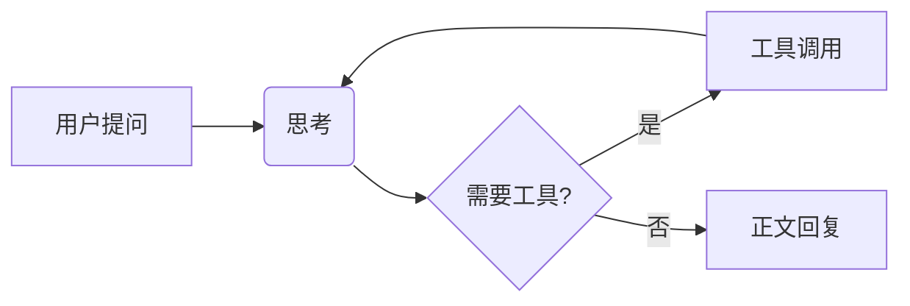

# 回复阅读节奏

这次调整已经完成。**先看结论，再按需查看细节**：正文、执行过程和代码各自有清晰的阅读层次。

这是一段较长的中文回复，用来检查连续阅读时的行距和换行。界面应该让注意力停留在内容上，重要信息有适度强调，普通说明保持安静。Kimi、OMP 和 Qoder 共用相同的排版，切换 Agent 后不需要重新适应。

## 这次改了什么

- **正文更好读**：采用 macOS 系统字体，中文与 English 混排保持一致。
  换行后的说明仍属于同一个段落，不会被拆成两块。
- **信息有层次**：列表的后续行与文字对齐，段落之间留出呼吸空间。这条较长的说明用于检查换行后的缩进，避免文字重新跑回圆点下面。
  - 子项用更小的缩进表达从属关系。
  - 支持 *轻度强调*、~~过期结论~~ 和 `inline_code`。

### 验收顺序

3. 先查看中文长段落和嵌套列表。
4. 再查看代码、引用和表格。

   第二段说明仍属于第四项，编号不会被重新开始。

- [x] 三种 Agent 共用回复样式
- [ ] 保留用户对实际阅读效果的反馈

> 这里只记录已验证的结果。
>
> 工具输出仍按需展开，阅读结论时不会被运行日志打断。

## 对比结果

| 内容 | 之前 | 现在 |
| :--- | :--- | :--- |
| 正文 | 按行切割 | 按段落排版，保留自然换行 |
| 列表 | 原始符号 | 编号、缩进与嵌套层级 |
| 代码 | 与正文混杂 | 独立区域，支持复制 |
| 中文表格 | 管道文本 | 原生表格，长内容自动换行 |

## 决策表：窄列与长列混排

窄列只保留自己需要的宽度，长列拿到剩余空间，整表仍填满阅读列宽。

| # | 场景 | 说明 | 列数 |
| ---: | :--- | :--- | :--- |
| 1 | 窄列混排 | 编号列只保留自己需要的宽度，长说明列拿到剩余空间，整表仍然填满阅读列宽 | 四列 |
| 2 | 长中文单元格 | 长句在自己的列宽内自然折行，不出现单字一行，也不把相邻列挤窄 | 四列 |
| 33 | 超宽表格 | 各列最小宽度之和超过阅读列宽时，表格自己横向滚动，不撑宽对话正文 | 四列 |

## 代码示例

下面的命令仅作展示，不会自动执行。`--host` 和文件路径保持等宽，长代码可以横向滚动。

```sh
KIMI_CODE_INFINITE_RETRY=true kimi web \
  --host 0.0.0.0 --port 58627 --no-open
printf '%s\n' '这是一行很长的代码，用来确认横向滚动不会撑宽对话正文，或把命令换行成看起来不同的内容。abcdefghijklmno/long/path/to/project/file.swift'
```

### 阅读与引用

参阅 [Swift Markdown 项目](https://github.com/swiftlang/swift-markdown)。链接使用克制的颜色，粗体只表达必要强调。

#### 更深的层级

H4 与正文同号，靠字重和留白分段；`inline_code()` 在标题里保持等宽。

## 数学与图示

行内公式 $E=mc^2$ 与正文同排不错位，价格 $5 和 $10 不触发渲染。

$$\frac{1}{2}\sum_{i=1}^{n} x_i^2 + \sqrt{\alpha^2 + \beta^2}$$



## 宽表：六列对比

六列及以上的宽表在自己的区域内横向滚动，正文列宽保持不变。

| 项目 | Alpha | Beta | Gamma | Delta | Epsilon |
| :--- | ---: | ---: | ---: | ---: | ---: |
| 吞吐量 tokens/s | 1,024 | 2,048 | 512 | 768 | 1,536 |
| 延迟 p99 ms | 120 | 240 | 90 | 180 | 300 |
| 一段较长的中文说明，用来检查单元格在自己的列宽内自然折行 | 3 | 1 | 4 | 1 | 5 |

## 长代码阅读

```python
def render_reply(document, width, theme):
    """一段足够长的 Python 代码，用来确认行号、缩进和横向滚动都保持可用。"""
    blocks = parse(document)
    for block in blocks:
        if block.kind == "table" and block.columns >= 4:
            yield table_scroll_region(block, width=width, theme=theme, note="宽表独立横滚，不撑宽正文")
        else:
            yield paragraph_region(block, width=width, theme=theme)
```

---

一段回复结束后，可以复制完整的 Markdown 原文，代码块也可以单独复制。

## 代码块边界形态

单行代码块也带语言栏与复制：

```bash
git status --short
```

无语言标注的块退化为纯文本卡：

```
plain output, no language tag — 纯文本也保持等宽与卡片形态
```

列表里的代码块跟随列表缩进，不越界：

- 先构建夹具：

  ```sh
  ./scripts/build-reading-preview.sh   # 构建截图夹具
  ```

引用里的代码块保持卡片完整：

> 一段说明：
>
> ```python
> print("引用内的代码块")  # 引用内的代码块保持卡片
> ```

长中文注释行的等宽折行与横滚二选一，看实现：

```text
// 这是一段故意写得很长的注释，用来确认代码块在横向滚动时不会把内容裁掉，渐隐只出现在真正溢出的场景。
let answer = 42
```

## 连续行内代码与标点

chip 填充本来就是不透明的 `#FAFAFA`，我多此一举用了 alpha。已改成不透明色值（浅 `#FAFAFA` / 深 `#292929`，与 DSH token 一致），`mention` 底色（`@"…"` 引用）同样处理。

## 行内代码的边界形态

跨行长 chip 折行时应该像一条连续的带子，不是两个独立胶囊：`Worktree/Perch/Sources/AgentWorkbench/ConversationTranscriptView.swift 里的 ProcessFoldRow 负责折叠头的状态文案与脉冲点`，折行处不断开。

行首 chip 开头：`README.md` 在行首，标点在外的 `token`，行尾收尾 `View.swift`。

连续 chip 之间：`a.swift`、`b.swift`、`c.swift` 三个紧邻，`x = 1` 和 `y = 2` 之间只有空格。

加粗里的 **重点 `code` 混合**，链接里的 [`linked`](https://example.com) 与 code 相邻 `chip`。
