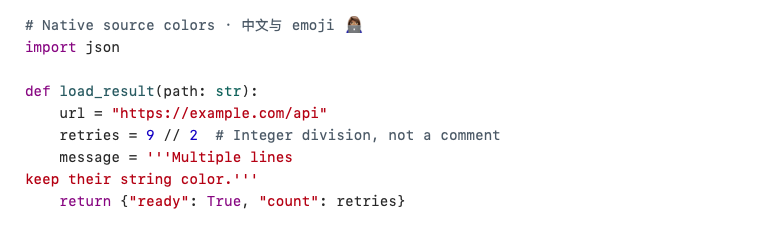
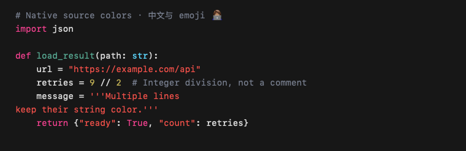

# Native code reading and syntax colors

Baseline: `302ed57ad71f2356151676791b249d98f86843e1`. Candidate: the code-reader changes accompanying this report. Local arm64 Mac, macOS 27.0.1 (26A434), Swift 6.4, Swift 5 mode, deployment target macOS 26. No application was installed, pushed or deployed by this work.

## Implementation

- Replace the shared four-regex approximation with the pinned highlight.js 11.11.1 common-language build. A serial actor owns JavaScriptCore; input is passed to `highlight` as data. Parse its public HTML result into UTF-16 token spans and verify that decoded text exactly matches the original, including CRLF and Unicode. Unknown languages remain plain text. No web view or network access is involved at runtime.
- File and native/SwiftUI conversation code share token types and an adaptive light/dark code palette. TextKit supplies colors while drawing, without replacing the original text, changing font metrics or invalidating full-document layout. Streaming changes wait for a 150 ms pause; obsolete tasks are cancelled and their identity checked. A bounded cache retains token values (24 entries, 8 MiB estimated source/token storage), never views.
- File text retains TextKit 1 but enables noncontiguous layout and native document sizing. Remove the synchronous full-container `ensureLayout`. The ruler uses source line offsets and actual visible code fragments instead of independently estimating a second complete text document.
- Search runs off the UI actor after a 120 ms typing pause. Text/query changes invalidate matches; next/previous only change selection. Search highlighting is also drawn without editing text storage. Remove the 5,000-result cap and discard results after a source/query change.

## Choice of engine

[highlight.js](https://github.com/highlightjs/highlight.js) provides existing multi-language grammars and a public string-to-highlighted-HTML API. Its fixed build is fetched with a checked SHA-256 by `scripts/prepare-highlight.sh`, and its BSD license is bundled. [Highlightr](https://github.com/raspu/Highlightr) now declares that it is unmaintained. [HighlightSwift](https://github.com/appstefan/HighlightSwift) offers an async Swift wrapper and styled text, but this reader needs semantic ranges with its existing fonts and draw-time coloring. [Neon](https://github.com/slsrepo/Neon) and tree-sitter offer incremental editing integration and language-specific parsers; this change keeps the existing read-only native text system.

## Matched component measurements

`swiftc -O`, a 960×600 native source viewport, production source font/fixed-line-height functions, highlight.js controller and search implementation. Input is `remote/native-agent-service.py` truncated or repeated to each target byte count. Four runs per arm, alternating baseline/candidate order. No other build or profiling job was started during the measurement. Other system load and display refresh rate were not measured.

The baseline applies the previous regex colors and lays out the full container before reading; the candidate shows plain source immediately and fills colors asynchronously. These measure **synchronous preparation for readable source**, not compositor presentation or time until syntax colors are complete. Neither arm includes file/network reading or the full SwiftUI file-window toolbar.

| Input | Baseline first readable, median (range) ms | Candidate first readable, median (range) ms | Candidate end jump, median ms |
| --- | ---: | ---: | ---: |
| 170,000 bytes | 63.49 (62.68–72.15) | 3.90 (3.66–4.45) | 3.03 |
| 1 MiB | 185.59 (180.71–189.39) | 4.16 (4.03–4.86) | 3.53 |
| 4 MiB | 754.35 (744.58–760.15) | 6.91 (6.82–7.38) | 4.65 |

Baseline end jumps were approximately 0.24–0.26 ms after paying for all layout up front. The candidate deliberately defers some work until a range is requested. Initial color completion waited about 187 ms at 170 KB and 975 ms at 1 MiB; subsequent cached requests completed within the 10–16 ms measurement polling interval. The 4 MiB token result exceeds the cache budget and took 4.05–4.14 s in the background on each run. The old implementation provided **no syntax colors at all** above 256,000 bytes.

The microbenchmark does not certify compositor frame rates, scrolling hitches or physical input experience. Native regression covers production components separately; the full-window SwiftUI mount timing printed by that fixture is a different metric and must not be compared directly with the table.

Raw results: [matched.jsonl](matched.jsonl). The local reproduction harness is `.local/source-render-audit/MatchedProbe.swift`; the durable functional fixture is `Tests/HostLifecycleChecks/CodeReaderChecks.swift`.

## Validation

- `python3 scripts/check-host-lifecycle.py --release --phase code-reader --phase file-reader --phase workspace-upgrade`: passed. Exercises real grammar colors during TextKit drawing, CRLF/CJK/emoji offsets, >3 MiB source, 45,000 search matches, no rescans during 20 next-result jumps, end-of-file visibility, cancellation/replacement, cached card reuse, native line-aligned reading-position restoration, and line-number toggling. File-window checks cover 480/720/1100 widths in light/dark appearances, selection, tabs, close cancellation and restored dimensions.
- `scripts/build-navigation-preview.sh` and `python3 scripts/run-navigation-check.py assistant-rows --output .local/source-render-audit/assistant-rows`: passed; 44 native/SwiftUI cases with zero maximum glyph or height drift.
- `swift run --build-system native -c release --skip-build WorkbenchChecks`: passed; live SSH integration was skipped.
- Preview source dependencies (20 targets), localization (1,371 scoped keys) and `git diff --check`: passed.

Local logs and build artifacts are under `.local/source-render-audit/`. These checks establish source/component correctness; they do not certify hosted CI, deployment, remote sessions or physical trackpad scrolling.

Native TextKit color samples (component rendering, not full-window screenshots):

